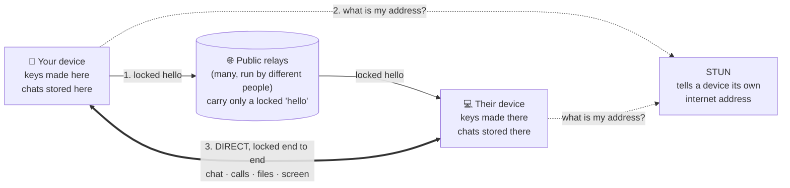
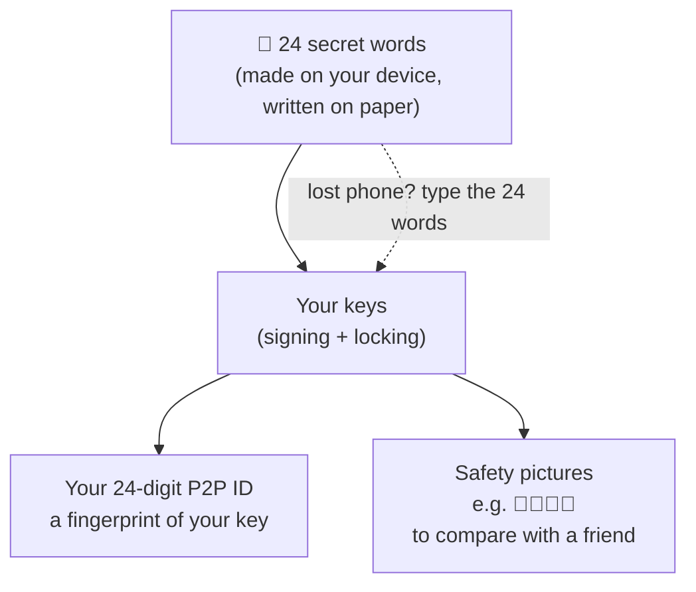
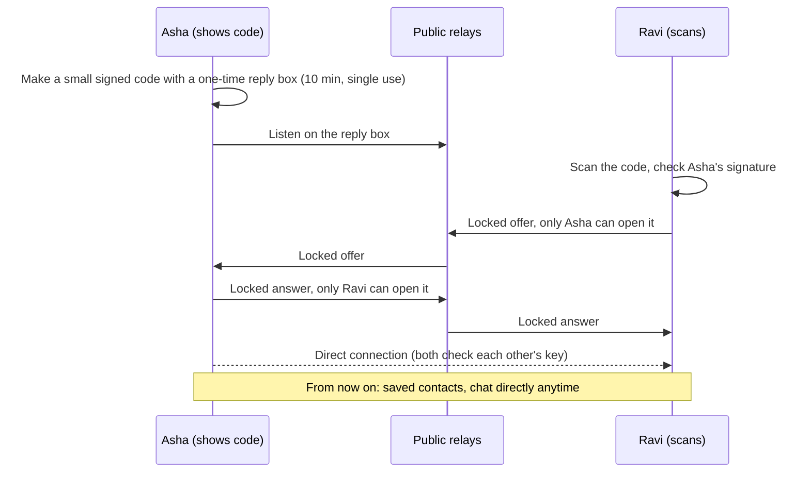
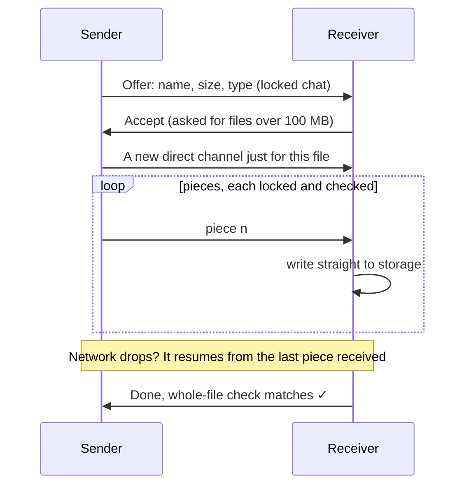
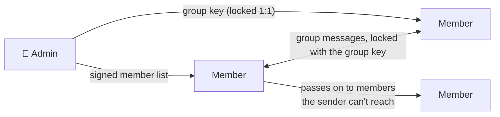

# P2P Talk

**Chats, voice and video calls, files and screen sharing, straight from your device to theirs.**
No phone number, no email, no account server, and nobody in the middle who can read anything.
Open source (Apache-2.0), made by [Vilnek](https://vilnek.in).

- **Use it now:** <https://p2p.vilnek.in> (any phone or computer; add it to your home screen)
- **Downloads:** Android app and how to check it's the real file: [download/README.md](download/README.md)
- **How it works, with diagrams:** [docs/OVERVIEW.md](docs/OVERVIEW.md)

---

## What you get

| | |
|---|---|
| **No number, no email** | Your account is 24 secret words, made on your device. Nothing is sent anywhere to sign up. |
| **Your 24-digit P2P ID** | A fingerprint of your key, for example `4821 0937 6612 3390 7745 1208`. Share it like a phone number. |
| **Add people your way** | Scan their QR code (one scan connects), send an invite link (works while you're offline, valid up to 24 hours), or type their P2P ID. |
| **Chats** | Text, with online / offline status. Kept on your device. |
| **Voice and video calls** | Direct between the two devices, with clear states: Reaching, Ringing, Connected. |
| **Screen sharing** | In a call, with your device's sound if you want. |
| **Files of any size** | Sent as the original, full quality. Live speed, pause, and resume if the network drops. Each file is checked when it arrives. |
| **Groups** | Messages locked with the group's key; members pass messages on to those the sender can't reach. Admins add and remove members and make other admins. |
| **Group calls** | Small voice and video calls with your group, each person connected directly to the others. |
| **Report and delete** | Block or report someone in one tap. Delete your account and everything on the device from Me. |
| **More than one device** | The same 24 words on another phone or computer give the same account and ID. |
| **Safety pictures** | Four emoji made from both keys. If they match on both screens, nobody is in the middle. |
| **No internet?** | Two devices on the same Wi-Fi can connect by swapping two codes, with no internet at all. |
| **Nothing collected** | No ads, no tracking, no analytics. Vilnek runs no server your chats or calls pass through. |

Honest about limits: a direct connection needs both devices online. There is no TURN relay by
design, so on some strict mobile networks a direct path isn't possible; the app then says so clearly.

## How it works



- The relays never see what you say, who it's for, or your files. They carry a locked "hello" so two
  devices can find each other; after that, everything goes **directly** between the two devices.
- Calls and chats never go through the relays.

### Your account is 24 words



Nobody can recover your words for you, so keep them on paper.

### One scan is enough



### Files of any size



### Groups



More diagrams (invite links while offline, how a connection gets through, call states, who can see
what): [docs/OVERVIEW.md](docs/OVERVIEW.md). Every message format and key step, with test vectors:
[docs/PROTOCOL.md](docs/PROTOCOL.md).

## Build from source

You need **Node 20 or newer** and, for the end-to-end tests, **Google Chrome**.

```sh
git clone https://github.com/vilnek/p2p.git
cd p2p
npm ci
npm run build          # type-check, then dist/p2p.html: one self-contained file
npm run check:urls     # the built file may contact only the allow-listed addresses
npm run preview        # serves dist/ at http://127.0.0.1:4317/p2p.html
```

The whole app is **one HTML file**, `dist/p2p.html`. All code and styles are inside it, and it
loads nothing from any server. It only talks to two public STUN servers and five public Nostr relays
(listed in the page's content policy and in `src/core/card.ts`).

Try it on one computer: open `http://127.0.0.1:4317/p2p.html` in a normal window and in a private
window (or two browser profiles), make an account in each, then add each other.

Camera, microphone and copy/paste need a secure page (`https://` or `localhost`). To try it on a
phone, use the live site, or serve `dist/` over HTTPS on your network.

## Tests

```sh
npm test               # unit tests (Vitest)
npm run test:e2e       # browsers talk to each other (Playwright, installed Chrome, port 4318)
```

- The end-to-end tests run two or more browser profiles that connect, chat, call, share screens,
  send files and make groups. They use their own tiny local relay (`tests/e2e/mock-relay.ts`) and
  **never contact the public relays**.
- No Chrome? `npx playwright install chromium`, then `PW_CHANNEL=chromium npm run test:e2e`.
- `npm run test:real` and `npm run probe:relays` do contact the real public relays. They are manual
  checks, not part of the normal test run.

Every pull request runs the same checks in GitHub Actions ([`.github/workflows/ci.yml`](.github/workflows/ci.yml)).

## Security

- Report security problems **privately**: see [SECURITY.md](SECURITY.md). Please don't open a public issue.
- What P2P Talk protects against, and what it can't: [docs/THREAT_MODEL.md](docs/THREAT_MODEL.md).
- The cryptography comes from audited open-source libraries: `@noble/curves`, `@noble/hashes`,
  `@scure/bip39`. Libraries and their licences: [THIRD_PARTY_NOTICES.md](THIRD_PARTY_NOTICES.md).

## Contributing

Pull requests are welcome. Please read [CONTRIBUTING.md](CONTRIBUTING.md) and the
[Code of Conduct](CODE_OF_CONDUCT.md) first. For a change to the protocol or the cryptography,
open an issue first.

## Licence

[Apache License 2.0](LICENSE). See also [NOTICE](NOTICE).

## Repository layout

| Folder | What |
|---|---|
| `/` (this folder) | The web app: `src/`, `tests/`, `scripts/`, `docs/`. It builds to one file, `dist/p2p.html` |
| [`native/`](native/) | The Android, iPhone/iPad and Mac apps: small native shells around the same web app |
| [`site/`](site/) | The hosting files for <https://p2p.vilnek.in> (security headers, Terms, Privacy) |
| [`brand/`](brand/) | The app icon and start animation the apps and the site are made from |

## Build the apps

Build the web app first (above), then follow [native/README.md](native/README.md) for Android, iPhone/iPad and Mac.

---

Made by **[Vilnek](https://vilnek.in)** · <https://p2p.vilnek.in>
