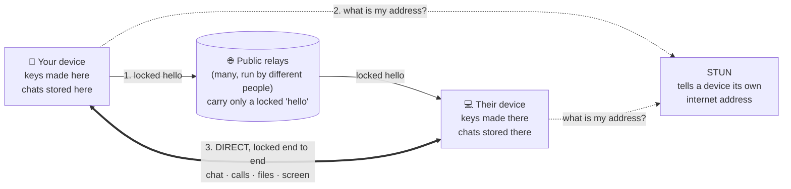
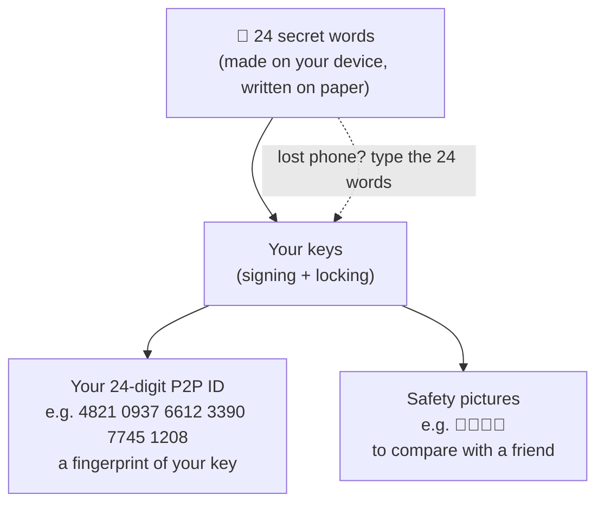
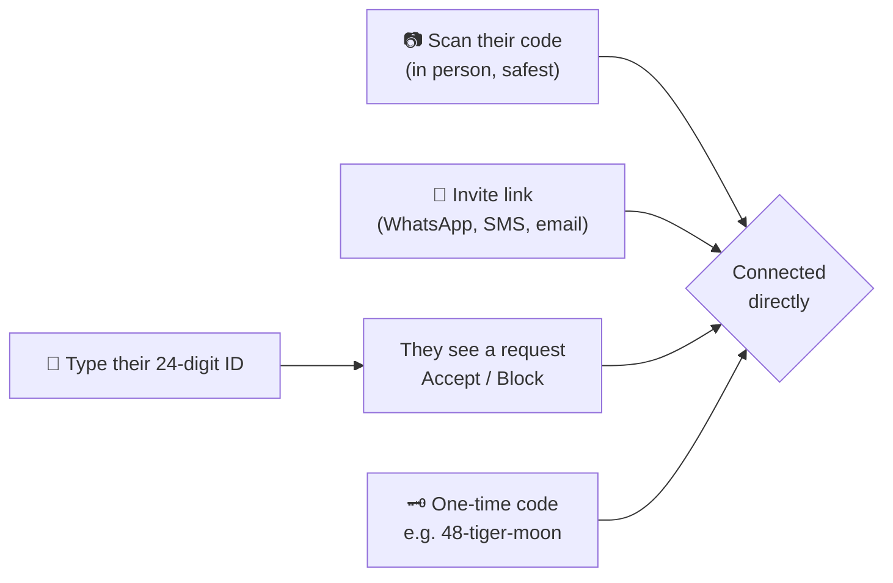
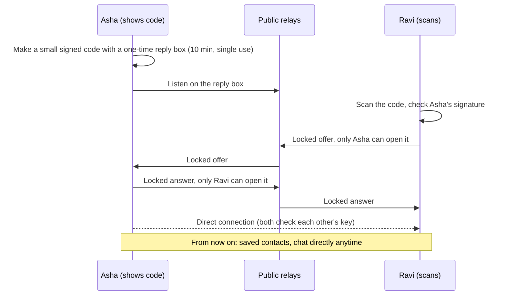
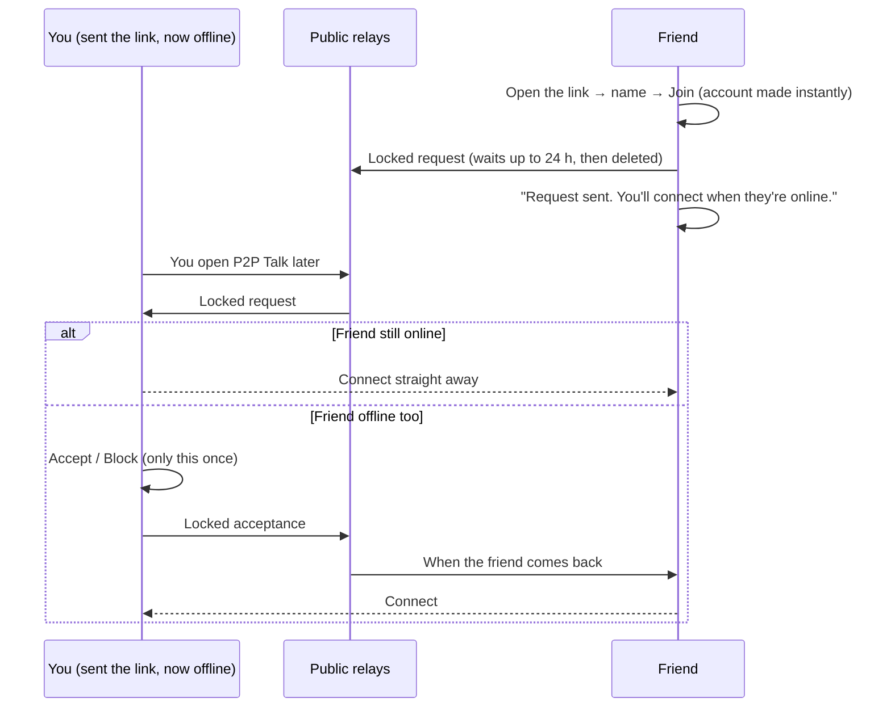
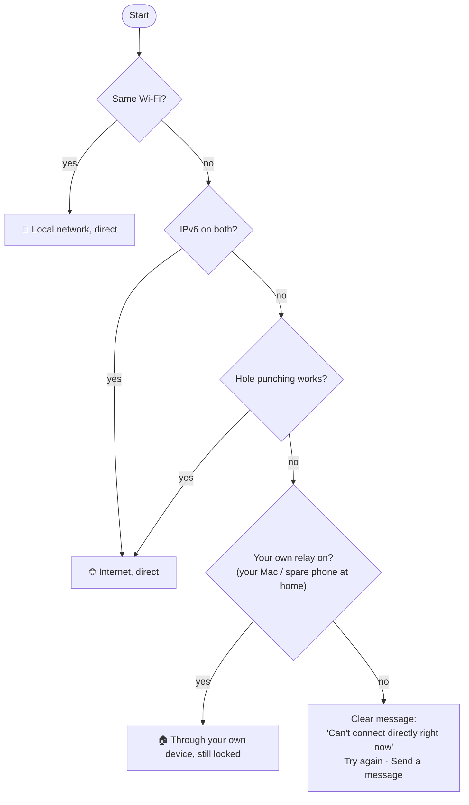
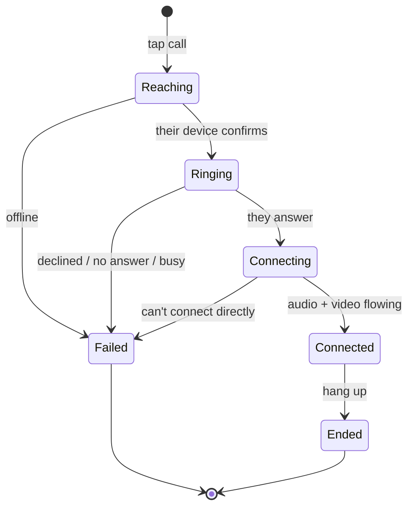
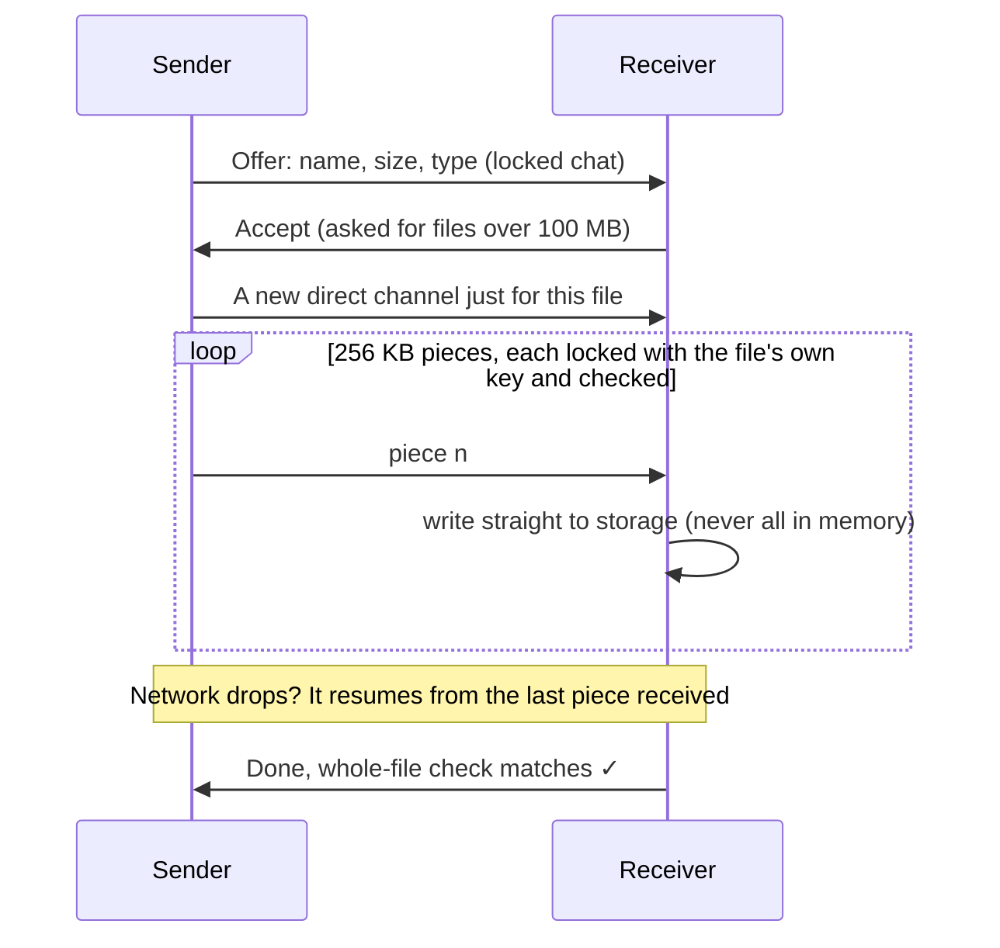
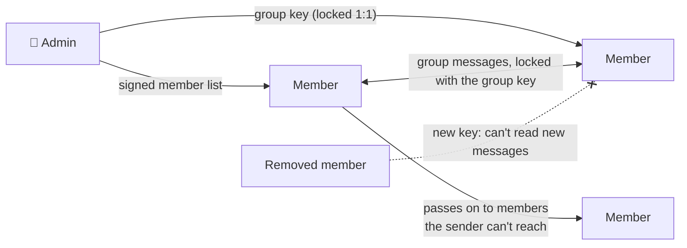
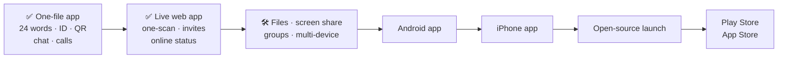

# P2P Talk: how it works

**Chats, voice and video calls, files, screen sharing and groups, straight from your device to theirs.**
No phone number, no email, no account server, and nobody in the middle who can read anything.
Open source (Apache-2.0), by [Vilnek](https://vilnek.in).

- **Use it now:** <https://p2p.vilnek.in> (any phone or computer; add it to your home screen)
- **Android app:** see [downloads](../download/README.md)
- **iPhone:** use the web app for now. The App Store and Play Store versions come after testing.

---

## 1. The big picture

- The relays never see what you say, who it's for, or your files.
- After the hello, everything goes **directly** between the two devices.
- Vilnek runs **no server** that your chats or calls pass through.

## 2. Your account is 24 words

- **Same 24 words on another device → same account, same ID.** Each device also has its own name ("iPhone", "Mac").
- **The ID can't be faked:** a different key always gives a different number.
- **Nobody can recover your words for you.** Keep them on paper.

## 3. Adding someone

### One scan is enough

### An invite link while you're offline

## 4. How a connection gets through

The iPhone app needs **Local Network** permission for same-Wi-Fi connections: it asks once at first launch.

## 5. Calls

- Voice and video, **directly between devices**.
- **Screen sharing** on computers (and in the phone apps later).
- Small group calls: up to about 4–6 people on video, 8 on voice.
- The call screen shows the same safety pictures on both sides: if they match, nobody is in the middle.

## 6. Files of any size

## 7. Groups

## 8. Who can see what

| Who | Can see | Never sees |
|---|---|---|
| **Vilnek** | Nothing. No server of ours in the path | Everything |
| Public relays | A locked hello, a random label, the address of the device talking to them | Your messages, files, calls, contacts |
| STUN servers | Your device's internet address for a moment | Anything else |
| The person you talk to | Your internet address (needed for a direct link) | — |
| Your mobile company / Wi-Fi | That your device talks to some addresses | Any content |

**No app can stop:** spyware on a phone, a camera pointed at the screen, or what the other person chooses to do. The phone apps block screenshots and screen recording where the system allows it.

## 9. Built with
TypeScript, WebRTC, audited open-source crypto (`@noble/curves`, `@noble/hashes`, `@scure/bip39`), the Nostr relay protocol for the hello, Capacitor for the phone apps. Full details: [PROTOCOL.md](PROTOCOL.md) · [THREAT_MODEL.md](THREAT_MODEL.md) · [SECURITY.md](../SECURITY.md) · [CONTRIBUTING.md](../CONTRIBUTING.md).

## 10. Roadmap

